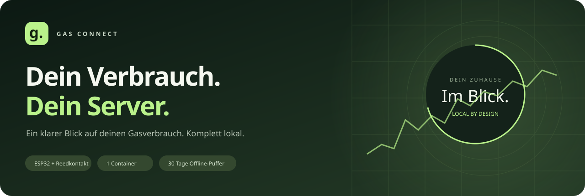
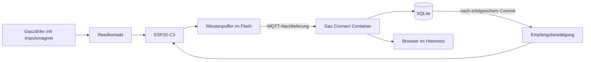

<div align="center">



**Dein Gaszähler wird sichtbar. Deine Daten bleiben zuhause.**

[](https://github.com/dj-nic/gas-connect-dashboard/actions/workflows/build.yml)
[](https://github.com/dj-nic/gas-connect-dashboard/releases)


[**⚡ ESP im Browser flashen**](https://dj-nic.github.io/gas-connect-dashboard/)
· [**🐧 Linux installieren**](#-in-wenigen-minuten-starten)
· [**📦 Releases**](https://github.com/dj-nic/gas-connect-dashboard/releases)
· [**📖 Anleitung**](docs/SETUP.md)

</div>

---

Gas Connect verbindet einen Gaszähler mit Reedkontakt und ESP32 mit einer eigenen, mobilen Weboberfläche. Ein einzelner Docker-Container enthält Dashboard, API, MQTT-Broker und SQLite. **Kein Home Assistant, kein Cloud-Konto und kein dauerhaft angeschlossener PC erforderlich.**

Fällt das Netzwerk oder der Server aus, zählt der weiter versorgte ESP selbstständig weiter. Abgeschlossene Minuten landen in seinem Flash-Puffer und werden nach der Wiederverbindung bestätigt und ohne Doppelzählung nachgetragen.

## ✨ Was du bekommst

| Im Dashboard | Im Sensor | Auf deinem Server |
|---|---|---|
| Aktueller Zählerstand und Durchfluss | Reedkontakt an GPIO4/GND | Genau ein Docker-Container |
| Heute, gestern, Monat und Jahr | Bis zu 30 Tage Minutenpuffer | SQLite in einem dauerhaften Datenordner |
| Verlauf für 24 h, 7/30 Tage und Jahr | CRC-gesichertes Ringjournal | Passwortgeschütztes Dashboard |
| WLAN-, Kontakt- und Synchronisationsstatus | Automatische Wiederholung bis zum Datenbank-ACK | Zufällig erzeugte Zugangsdaten |
| Optional geschätzte Kosten in €/m³ | Einstellbare Entprellzeit | Betrieb im eigenen LAN |

## 🧭 So fließen die Daten



Wiederholte Nachrichten werden über Gerätekennung und Sequenznummer erkannt. Der ESP gibt einen offenen Eintrag erst nach der Bestätigung des Servers frei. [Protokoll und Grenzen →](docs/ARCHITECTURE.md)

## 🚀 In wenigen Minuten starten

Du brauchst einen Linux-Server mit **Docker Engine + Compose v2**, einen **Waveshare ESP32-C3-Zero mit 4 MB Flash**, einen Reedkontakt und einen passenden Gaszähler mit Impulsmagnet. Die Pinbelegung ist für das NG3D-Kit ausgelegt. Andere Boards und Zähler sind nicht pauschal verifiziert.

### 1. Server installieren

```bash
curl -fsSL https://raw.githubusercontent.com/dj-nic/gas-connect-dashboard/v0.2.0/install.sh -o gas-connect-install.sh
bash gas-connect-install.sh
```

Der Installer fragt nach **deiner** Server-LAN-IP, baut den Container und prüft dessen Zustand. Er legt Daten unter `~/.local/share/gas-connect/data/` ab. Standardports: **8086** für die Oberfläche und **1883** für MQTT. Docker selbst wird nur auf ausdrücklichen Wunsch mit `--install-docker` nachinstalliert.

Für unbeaufsichtigte Installation den Platzhalter durch die eigene Adresse ersetzen:

```bash
bash gas-connect-install.sh --non-interactive --bind "<SERVER-LAN-IP>"
```

### 2. Dashboard einrichten

`http://<SERVER-LAN-IP>:8086` öffnen. Den Einrichtungscode auf dem eigenen Server anzeigen:

```bash
docker exec gas-connect cat /data/setup-token
```

Eigenes Passwort setzen, Impulswert laut Typenschild speichern und das Sensor-Passwort unter **Sensor einrichten** anzeigen. Es gibt keine gemeinsam genutzten Standard-Zugangsdaten.

### 3. ESP flashen — du hast die Wahl

| Weg | Start | Port-Erkennung |
|---|---|---|
| **Im Browser** | [Web-Installer öffnen ↗](https://dj-nic.github.io/gas-connect-dashboard/) | Betriebssystem-/Browser-Dialog; angeschlossenes USB-Gerät bewusst auswählen |
| **Windows** | Release entpacken und **`Flash ESP.cmd`** öffnen | Nummerierte COM-Liste mit Beschreibung, USB-ID und Seriennummer; erneuter Scan und Einsteckvergleich |
| **Linux / macOS** | `bash scripts/flash.sh` | Serielle Geräte mit denselben Auswahlhilfen |
| **VS Code lokal** | **Terminal → Task ausführen → ESP: Flash-Assistent** | Zusätzliche Tasks für Port-Liste und Einsteckvergleich |

Der lokale Assistent benötigt **Python 3.10+ oder uv**. Er richtet seine Werkzeuge isoliert ein, prüft die Firmware-Prüfsumme und verlangt vor dem Schreiben eine Bestätigung. Ein Quellcode-Download kann die zur Version passende Firmware automatisch aus dem öffentlichen Release laden.

**USB bleibt lokal:** GitHub Actions und Codespaces können deinen am PC angeschlossenen ESP nicht direkt erreichen. Der README-Link öffnet eine HTTPS-Seite auf GitHub Pages; dein Browser flasht das dort ausgewählte Gerät. Browser dürfen aus Sicherheitsgründen nicht ungefragt alle COM-Ports auslesen. [Flashen und USB-Erkennung ausführlich →](docs/FLASHING.md)

### 4. Sensor verbinden

Nach dem Flash ohne BOOT neu starten, das WLAN `Gas-Setup-<Suffix>` öffnen und WLAN-/Serverdaten sowie das Sensor-Passwort eintragen. Anschließend den physischen Zählerstand im Dashboard abgleichen. [Schritt für Schritt →](docs/SETUP.md)

## 🔒 Persönliche Daten bleiben lokal

- Dieses Repository und seine Firmware enthalten keine voreingestellte persönliche Server-IP, WLAN-Zugangsdaten oder Geräteschlüssel.
- Jeder Server erzeugt eigene Zugangsdaten zur Laufzeit. Die konkrete Serveradresse wird erst bei deiner Einrichtung gesetzt.
- `data/`, `.env`, Backups der Umgebung und lokale Flash-Caches werden nicht versioniert.
- Der Standard beim manuellen Start bindet nur an Loopback. Der Installer verlangt oder erfragt die konkrete eigene LAN-Adresse.
- Ein Prüfskript untersucht Veröffentlichungen auf versehentliche private LAN-Adressen, einschließlich des erzeugten Firmware-Abbilds.

Die feste Adresse `192.168.4.1` ist ausschließlich der generische temporäre ESP-Setup-Zugang. Sie ist keine Server-Voreinstellung. Im Heimnetz verwendet MQTT Passwortschutz ohne TLS; für untrusted Netzwerke sind zusätzliche Maßnahmen nötig. Der Installer öffnet keine Routerports.

## 📚 Dokumentation

| Thema | Link |
|---|---|
| Installation, erste Anmeldung, Updates und Backup | [Setup-Anleitung](docs/SETUP.md) |
| Web-Installer, COM-Scan, VS-Code-Tasks und BOOT-Modus | [Flash-Anleitung](docs/FLASHING.md) |
| Puffer, Empfangsbestätigung und Datenschema | [Architektur](docs/ARCHITECTURE.md) |
| Entwicklungsumgebung und Prüfungen | [Entwicklung](docs/DEVELOPMENT.md) |

## 🧪 Was geprüft ist — und was noch am Gerät zu prüfen bleibt

Die CI prüft Backend-Regressionsfälle, Flash-Assistent, Veröffentlichungsdaten und Containerbetrieb samt MQTT-Nachlieferung über einen Neustart. Sie kompiliert außerdem die ESP32-C3-Firmware mit dem festgelegten Partitionslayout.

**Noch kein Versprechen einer Hardware-Dauerprüfung:** Erstflash, WLAN-Einrichtung, echte Reedkontakte und ein über 30 Tage gefülltes LittleFS-Journal müssen am physischen Gerät geprüft werden. Der Puffer erfasst Kommunikationsausfälle bei weiter versorgtem ESP. Während der ESP stromlos ist, kann er keine Pulse zählen; die noch offene Minute kann bei abruptem Stromverlust verloren gehen. Nach mehr als 30 Tagen ohne Bestätigung wird die älteste Minutenhistorie überschrieben und dieser Zustand angezeigt.

## 🙌 Herkunft und Bausteine

Funktionsumfang und GPIO-Belegung orientieren sich an [NG3D-Druck/Gas-Connect-DIY](https://github.com/NG3D-Druck/Gas-Connect-DIY). Die hier enthaltene Firmware ist eine eigenständige Arduino/PlatformIO-Implementierung; Oberfläche, Server und bestätigter Minutenpuffer sind eigene Ergänzungen. Es besteht keine offizielle Verbindung zu NG3D, einem Zählerhersteller oder Energieversorger.

Mit [ESP Web Tools](https://esphome.github.io/esp-web-tools/), [esptool](https://github.com/espressif/esptool), [PlatformIO](https://platformio.org/), [Mosquitto](https://mosquitto.org/), [FastAPI](https://fastapi.tiangolo.com/) und [SQLite](https://sqlite.org/). Die jeweiligen Komponenten behalten ihre eigenen Lizenzen.
